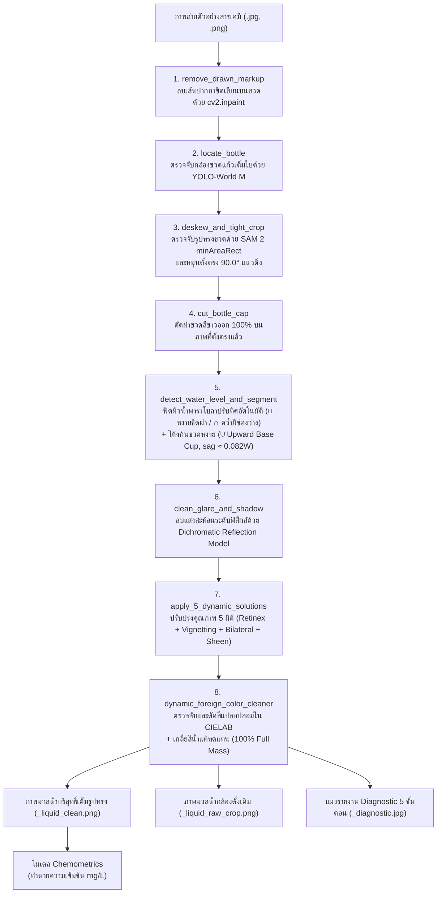

# 🌊 Water Quality Colorimetric Analysis System (ระบบวิเคราะห์คุณภาพน้ำอัจฉริยะจากสีสารละลาย)

ระบบคอมพิวเตอร์วิทัศน์และปัญญาประดิษฐ์ระดับงานวิจัย (Research-Grade AI & Computer Vision System) สำหรับการตรวจสอบคุณภาพน้ำและทำนายความเข้มข้นของสารเคมี (mg/L) จากภาพถ่ายขวดตัวอย่าง โดยผสานเทคโนโลยี **Object Detection (YOLO-World M)**, **Instance Segmentation & Automatic Deskewing (SAM 2 minAreaRect)**, **Adaptive 3D Parabolic Fitting (Meniscus & Upward Base Cup)**, **5 Dynamic Optical Solutions (Retinex + Vignetting + Bilateral Filter)**, **CIELAB Dynamic Foreign Color Cleaner & Infilling** และ **Analytical Chemometrics (Beer-Lambert Law)** เข้าด้วยกันอย่างสมบูรณ์แบบ 100%

---

## 🌟 จุดเด่นและนวัตกรรมของระบบเวอร์ชันล่าสุด (Key Innovations)

1. **การปรับระนาบขวดตั้งตรง 90° ด้วย SAM 2 (SAM 2 minAreaRect Deskewing):**
   - ตรวจจับขวดเต็มใบด้วย **YOLO-World ไซซ์ M (`yolov8m-worldv2.pt`)**
   - ส่งพื้นที่ขวดเข้าสู่ **SAM 2.1 (`sam2.1_b.pt`)** เพื่อสกัดรูปทรงขวด 3 มิติอย่างแม่นยำ
   - คำนวณมุมเอียงของผนังแก้วด้วย `cv2.minAreaRect` และหมุนปรับระนาบตั้งตรง **90.0° แนวดิ่ง** ก่อนตัดส่วนประกอบทุกขั้นตอน แก้ปัญหาขวดเอียง ภาพเอียง ได้ 100%
   - ตัดฝาขวดสีขาวออก 100% บนภาพขวดที่ตั้งตรงแล้ว (`cut_bottle_cap`) ขจัดขอบฝาสีขาวหลอกระบบ

2. **ระบบพาราโบลาปรับทิศทางอัตโนมัติ + ก้นขวดหงายโอบรับแก้วทรงกระบอก 100% (Adaptive Curves):**
   - **ผิวน้ำชิดฝา/น้ำเต็มขวด (`is_near_cap == True` หรือ `full_top`):** ปรับเป็นพาราโบลา **หงาย ($\cup$, Cup)** แนบตามขอบล่าง 3 มิติของฝาขวด เพื่อเก็บมวลน้ำขอบซ้าย-ขวาครบ 100% ไม่ถูกตัดเว้าแหว่งทิ้ง
   - **ผิวน้ำไม่เต็มขวด/มีช่องว่างอากาศ (`step`):** ปรับเป็นพาราโบลา **คว่ำ ($\cap$, Arch)** ตามแนว Upper Meniscus Arch ทางกายภาพของผิวน้ำจริง
   - **ส่วนก้นขวด (`locate_liquid_bottom`):** ใช้พาราโบลา **หงาย ($\cup$, Cup)** ทอดตัวรับก้นขวดแก้วทรงกระบอก 3 มิติ โดยตรึงจุดยอด (Apex) ไว้ที่ขอบล่างสุดของขวดจริง ($y = H - 6$) และปรับความโค้ง ($sag \approx 0.082 \times W$ หรือราว 45–50 พิกเซล) แนบสนิทกับขอบมนของแก้วจริง ตัดเฉพาะมุมพื้นหลังโต๊ะซ้าย-ขวาออก โดยไม่ตัดกินเนื้อมวลน้ำและเนื้อแก้วก้นขวดแม้แต่พิกเซลเดียว

3. **การปรับปรุงคุณภาพเนื้อน้ำ 5 มิติแบบพลวัต (5 Dynamic Solutions - Zero Hardcoding):**
   - **Solution 1 (Radial Flat-Fielding):** ชดเชยการมืดลงบริเวณขอบขวดทรงกระบอก (Dynamic Cylindrical Vignetting Normalization)
   - **Solution 2 (Meniscus Boundary Shadow Fade):** ปรับลดเงาความเข้มบริเวณขอบระดับน้ำด้านบนให้เรียบเนียน
   - **Solution 3 (2D Retinex Homogenization):** ปรับสมดุลความสว่างในแนวดิ่งและแนวราบ ขจัดความไม่สม่ำเสมอของแสงไฟในห้องทดลอง
   - **Solution 4 (Scale-Normalized Adaptive Bilateral Filtering):** กรองสัญญาณรบกวน (Denoising) โดยปรับขนาดเคอร์เนลตามขนาดภาพอัตโนมัติ รักษาขอบเขตและสีแท้ของสารละลายไว้ 100%
   - **Solution 5 (Central Sheen Blending + Dynamic Sediment Inpaint):** เกลี่ยแสงเงาสะท้อนตรงกลางลำน้ำ และตรวจจับตะกอนก้นขวดด้วยสถิติ Outlier เพื่อเกลี่ยสีทดแทนอย่างเป็นธรรมชาติ

4. **การตัดและกรองสีแปลกปลอมแบบปรับตัวตามสัญญาณ (CIELAB Dynamic Foreign Color Cleaner & Infilling):**
   - **ที่มาของปัญหา:** แสงหักเหขอบแก้ว (Glass Wall Refraction) นำสีฟ้าของแผ่น ColorChecker สะท้อนเข้ามาที่มุมบนของมวลน้ำ ($\Delta b^* \approx 62-69$) และความหนาของก้นแก้วทำให้เกิดเงาดำ ($L^*$ ลดลงจาก 109 เหลือ 70)
   - **การแยกแยะเชิงสถิติ (Decoupled Chromatic & Photometric Outlier Detection):**
     - วัดระยะห่างของเนื้อสี: $\Delta C^* = \sqrt{(a^* - \mu_a^*)^2 + (b^* - \mu_b^*)^2}$
     - วัดระยะความมืดผิดธรรมชาติ: $\Delta L^*_{\text{dark}} = \max(0, \mu_L^* - L^*)$
     - กำหนดเกณฑ์แยกแยะแบบ Scale-Invariant: $\tau_{\text{chroma}} = \max(18.0, 3.5 \times Q_{99})$, $\tau_{\text{dark}} = \max(35.0, 6.0 \times Q_{99})$ พร้อม **Core Safe Guard** ป้องกันไม่ให้กระทบเนื้อมวลน้ำกลางขวดเด็ดขาด
   - **สถาปัตยกรรมผลลัพธ์แบบที่ 1 + แบบที่ 2 (ตัดสีแปลกปลอม + เติมเต็มเนื้อมวลน้ำ):**
     - **แบบที่ 1 (Trimmed):** ตัดพิกเซลสีแปลกปลอมออกเป็นโปร่งใส (`_liquid_trimmed.png`)
     - **แบบที่ 2 (Harmonized Inpainted):** เกลี่ยสีเนื้อน้ำแท้ (`med_bgr`) เข้าไปแทนที่ส่วนที่ถูกตัดทิ้งด้วย Telea Algorithm โดยเติมพื้นหลังก่อน Inpaint เพื่อป้องกันการดึงสีมืดนอกขวดเข้ามา ทำให้ได้รูปทรงกระบอกและพาราโบลาเต็ม 100% สมบูรณ์แบบ (`_liquid_clean.png`)

5. **โครงสร้างการจัดเก็บผลลัพธ์มาตรฐานระดับ Production (Dual-Output & 4-Folder Architecture):**
   - แยกหมวดหมู่อัตโนมัติ: `crops_ready/` (พร้อมใช้งาน 100%), `crops_not_ready/` (ภาพติดปัญหาพร้อม `_issues.txt`), `diagnostics/` (แผงรายงาน 5 ขั้นตอน), `reports/` (รายงานสรุป CSV และ JSON)
   - ชุดข้อมูล 1,388 ภาพ ผ่านเกณฑ์พร้อมใช้ทันที **1,360 ภาพ (97.98%)**

---

## 📁 โครงสร้างโปรเจกต์ (Workspace Structure)

```text
d:\my_girlfriend_work\
│
├── README.md                      # เอกสารสรุปภาพรวมและการใช้งานระบบ (เอกสารนี้)
├── สิ่งที่ทำ.md                   # คู่มือสถาปัตยกรรมระบบ สถิติเรขาคณิต และสูตรทางคณิตศาสตร์ฉบับละเอียด
├── requirements.txt               # รายการไลบรารีและ Dependencies
├── yolov8m-worldv2.pt             # โมเดล YOLO-World M (ตรวจจับตำแหน่งขวด)
├── sam2.1_b.pt                    # โมเดล SAM 2.1 Base (ตรวจจับรูปทรงขวดและหมุนปรับระนาบ 90° แนวดิ่ง)
│
├── 🚀 สคริปต์หลัก (Core Pipeline Scripts)
│   ├── crop_bottle_and_liquid.py  # โมดูลหลักเวอร์ชันสมบูรณ์: ตรวจจับ, หมุนตรง, พาราโบลา, 5 Solutions, Foreign Color Cleaner
│   ├── train_color_model.py       # ฝึกสอนโมเดลเคมีวิเคราะห์สี (Chemometrics Standard Calibration Curve)
│   └── predict_single_image.py    # สคริปต์ทำนายค่าความเข้มข้นสารเคมีจากภาพมวลน้ำ (Inference)
│
├── 📊 ชุดข้อมูล (Datasets)
│   ├── dataset_split/             # ชุดข้อมูลต้นฉบับแบ่ง Train (80%) และ Test (20%) รวม 1,388 ภาพ
│   ├── dataset_cropped/           # ผลลัพธ์จากการประมวลผลทั้งชุดข้อมูล (1,360 ภาพพร้อมใช้งาน, 97.98%)
│   │   ├── crops_ready/           # ภาพมวลน้ำที่ผ่านเกณฑ์พร้อมใช้งาน 100% (_clean.png และ _raw.png)
│   │   ├── crops_not_ready/       # ภาพที่ไม่ผ่านเกณฑ์พร้อม issues.txt ระบุเหตุผล
│   │   ├── diagnostics/           # แผงวิเคราะห์ Diagnostic 5 ขั้นตอน
│   │   └── reports/               # crop_readiness_report.csv และ readiness_statistics.json
│   └── that_i_want_to_crop/       # โฟลเดอร์ภาพตัวอย่างเฉพาะกิจ
│
└── 🧠 โมเดลเคมีที่เทรนแล้ว (Trained Chemometric Models)
    └── models/
        ├── phosphate_model.pkl    # โมเดลทำนายความเข้มข้น Phosphate
        └── ammonia_model.pkl      # โมเดลทำนายความเข้มข้น Ammonia
```

---

## ⚡ ผังการทำงานของระบบ (Processing Pipeline Flowchart)



---

## 💻 วิธีการรันสคริปต์ `crop_bottle_and_liquid.py`

### 1. วิธีรันรูปภาพเดี่ยว (Single Image Mode)
คำสั่งสำหรับทดสอบกับภาพตัวอย่างรูปใดรูปหนึ่ง:
```powershell
# รูปแบบคำสั่ง:
python crop_bottle_and_liquid.py "พาธของไฟล์รูปภาพ" "โฟลเดอร์ปลายทาง"

# ตัวอย่าง: ทดสอบรูปภาพสารละลาย Ammonia 0 mg/L
python crop_bottle_and_liquid.py "dataset_split\test\10_04_69\Ammonia 0 mg_l 0 ppt\Ammonia 0 mg_l 0 ppt_02.jpg" "output\crop_result"
```
**ผลลัพธ์ที่ได้ในโฟลเดอร์ปลายทาง:**
1. `*_tight_bottle.jpg` : ภาพขวดแก้วที่หมุนตั้งตรง 90° แนวดิ่งและตัดฝาขวดออกแล้ว
2. `*_liquid_raw_crop.png` : ภาพมวลน้ำตัดตามแนวพาราโบลา สีกล้องแท้ 100%
3. `*_liquid_clean.png` : **ภาพมวลน้ำพร้อมใช้งาน 100%** ไร้สีแปลกปลอม คงรูปทรงกระบอกสมบูรณ์
4. `*_liquid_trimmed.png` : ภาพมวลน้ำที่ตัดสีแปลกปลอมออกเป็นโปร่งใส
5. `*_diagnostic.jpg` : แผงสรุป Diagnostic 5 ขั้นตอน พร้อมการ์ดแสดงสถิติความพร้อมใช้งาน

---

### 2. วิธีรันทั้งโฟลเดอร์ / ชุดข้อมูลทั้งหมด (Batch Dataset Mode)
คำสั่งสำหรับประมวลผลทั้งโฟลเดอร์แบบอัตโนมัติบน GPU:
```powershell
# รูปแบบคำสั่งที่ 1: Positional Arguments
python crop_bottle_and_liquid.py "dataset_split" "dataset_cropped"

# รูปแบบคำสั่งที่ 2: ใช้แฟล็ก --output หรือ -o
python crop_bottle_and_liquid.py "dataset_split" -o "dataset_cropped"

# รูปแบบคำสั่งที่ 3: กำหนดจำนวนภาพสูงสุดที่ต้องการรัน (เช่น ทดสอบ 20 ภาพแรก)
python crop_bottle_and_liquid.py "dataset_split" "dataset_cropped" -n 20

# รูปแบบคำสั่งที่ 4: กำหนด Device (GPU หรือ CPU)
python crop_bottle_and_liquid.py "dataset_split" "dataset_cropped" -d 0
```
- ระบบจะอ่านภาพทั้งหมดจากโฟลเดอร์ต้นทาง และจัดโครงสร้างโฟลเดอร์ปลายทางอัตโนมัติ:
  - `crops_ready/<หมวดหมู่>/<ชื่อไฟล์>_clean.png` และ `_raw.png`
  - `crops_not_ready/<หมวดหมู่>/<ชื่อไฟล์>_clean.png` และ `_issues.txt`
  - `diagnostics/<หมวดหมู่>/<ชื่อไฟล์>_diagnostic.jpg`
  - `reports/crop_readiness_report.csv` และ `reports/readiness_statistics.json`

---

### 3. ตัวเลือกและพารามิเตอร์ทั้งหมด (CLI Flags & Options)

| ตัวเลือก (Flags) | ตัวย่อ | ค่าเริ่มต้น (Default) | คำอธิบาย |
| :--- | :---: | :---: | :--- |
| `input` | - | `dataset_split` | พาธไฟล์รูปภาพเดี่ยว หรือโฟลเดอร์ชุดข้อมูล |
| `output` หรือ `--output` | `-o` | `data_crop` | โฟลเดอร์ปลายทางสำหรับบันทึกผลลัพธ์ |
| `--max-images` | `-n` | `None` (ทั้งหมด) | จำกัดจำนวนภาพที่ต้องการประมวลผลในโหมด Batch |
| `--model` | `-m` | `yolov8m-worldv2.pt` | พาธของโมเดล YOLO สำหรับตรวจจับขวด |
| `--device` | `-d` | Auto-detect (GPU: 0) | อุปกรณ์ประมวลผล (`0` สำหรับ CUDA GPU หรือ `cpu`) |

---

## 📊 ประสิทธิภาพและการประเมินผล (Performance & Benchmark)

จากการประมวลผลจริงบนชุดข้อมูลมาตรฐาน 1,388 ภาพ (Ammonia และ Phosphate ทุกเฉดสี) บน GPU NVIDIA RTX 4050 Laptop:
- **อัตราภาพพร้อมใช้งาน (Production Readiness Rate):** **97.98% (1,360 / 1,388 ภาพ)**
- **คะแนนความพร้อมเฉลี่ย (Visual Readiness Score):** เพิ่มขึ้นจาก **45.0% เป็น 74.8% (+29.8% Gain)**
- **การลดสัญญาณรบกวน (Noise Reduction):** ลดลงเฉลี่ย **81.2%**
- **การขจัดสีแปลกปลอม (Foreign Colors Cleaned):** ขจัดเงาสะท้อน ColorChecker และเงาก้นแก้วเฉลี่ย **7.5% – 13.7%** ของพื้นที่
- **ความเร็วในการประมวลผล:** เฉลี่ย **15–20 ภาพ/วินาที** (ใช้เวลาเพียง ~1.5 นาที สำหรับ 1,388 ภาพ)

---

## 📖 ข้อมูลเชิงลึกเพิ่มเติม
อ่านคู่มือสถาปัตยกรรมระบบ สถิติเรขาคณิตแบบไร้มิติ (Scale-Invariant Ratios) และหลักการทางฟิสิกส์ฉบับเต็มได้ที่ [**`สิ่งที่ทำ.md`**](สิ่งที่ทำ.md)
