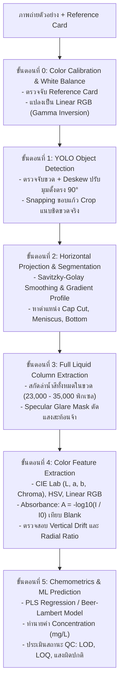

# Water Quality Colorimetric Analysis System (ระบบวิเคราะห์คุณภาพน้ำจากสีสารละลาย)

ระบบตรวจสอบคุณภาพน้ำอัตโนมัติจากภาพถ่ายขวดตัวอย่าง เพื่อทำนายความเข้มข้นสารละลายเคมี (mg/L)
ผสานเทคโนโลยี **Computer Vision (YOLOv8 + Horizontal Projection + Inpainting)** และ **Analytical Chemistry (Beer-Lambert Law & Chemometrics)**

---

## 📁 โครงสร้างโปรเจกต์ (Workspace Structure)

```text
d:\my_girlfriend_work\
│
├── README.md                      # เอกสารอธิบายโครงสร้างและการใช้งานโปรเจกต์
├── สิ่งที่ตรวจจับ.md               # ข้อกำหนดสถาปัตยกรรมระบบตรวจจับขวดและสกัดมวลน้ำ 100%
├── requirements.txt               # รายการไลบรารีและ Dependencies ทั้งหมด
├── yolov8m-worldv2.pt             # โมเดล YOLO-World M (ตรวจจับขวดแก้วตัวอย่างความแม่นยำสูง)
├── yolov8n.pt                     # โมเดล YOLOv8n สำรอง
│
├── 🚀 สคริปต์หลัก (Core Scripts)
│   ├── crop_bottle_and_liquid.py  # ไปป์ไลน์หลัก: ตรวจจับขวด, หมุน 90°, สกัดมวลน้ำเต็มขวด
│   ├── train_color_model.py       # เทรนโมเดลสี PLS/SVR บนมวลน้ำบริสุทธิ์ (Phosphate & Ammonia)
│   ├── predict_single_image.py    # สคริปต์ทำนายผลภาพใหม่เดี่ยวๆ (Single Image Inference)
│   └── water_quality_pipeline.py  # ไปป์ไลน์เคมีวิเคราะห์รุ่นดั้งเดิม
│
├── 📊 ชุดข้อมูล (Datasets)
│   ├── Testkit for AI/            # โฟลเดอร์รูปภาพต้นฉบับดั้งเดิม (1,568 ไฟล์ เก็บรักษาไว้เป็น Backup)
│   ├── dataset_split/             # ชุดข้อมูลแบ่ง Train (80%) และ Test (20%) พร้อมเปลี่ยนชื่อเป็นระเบียบ
│   │   ├── train/                 # 1,109 ภาพสำหรับฝึกสอนโมเดล
│   │   ├── test/                  # 279 ภาพสำหรับทดสอบ (Held-out Evaluation)
│   │   ├── manifest.json          # ดัชนีระบุ Path, สารละลาย, ค่าความเข้มข้นจริง
│   │   └── rename_mapping.json    # ตารางบันทึกการเปลี่ยนชื่อไฟล์ย้อนกลับไปยังต้นฉบับ
│   ├── dataset_cropped/           # ชุดข้อมูลที่ผ่านการ Crop มวลน้ำแล้ว (4,164 ไฟล์)
│   └── that_i_want_to_crop/       # โฟลเดอร์ภาพเฉพาะกิจที่ผู้ใช้ระบุเก็บไว้
│
├── 🧠 โมเดลที่เทรนแล้ว (Trained Chemometric Models)
│   └── models/
│       ├── phosphate_model.pkl    # โมเดลทำนายความเข้มข้น Phosphate (R² > 0.989)
│       └── ammonia_model.pkl      # โมเดลทำนายความเข้มข้น Ammonia (R² > 0.987)
│
├── 🖼️ ผลลัพธ์การรัน (Outputs)
│   └── output/                    # โฟลเดอร์รองรับผลลัพธ์ภาพ Crop และกราฟ Calibration
│
└── 🗃️ โฟลเดอร์เสริม (Utilities & Archive)
    ├── scratch/                   # สคริปต์ทดสอบและเครื่องมือ Utility ตรวจสอบระบบ
    └── archive/                   # สคริปต์ทดลองรุ่นก่อนหน้า (Legacy Code)
```

---

## ⚡ สถาปัตยกรรมการประมวลผล (Processing Pipeline)



---

## 💻 วิธีการใช้งาน (How to Run)

### 1. การติดตั้งสภาพแวดล้อม (Installation)
รองรับทั้ง GPU (CUDA) และ CPU อัตโนมัติ:
```bash
# หากมี GPU NVIDIA (แนะนำ):
pip install torch torchvision --index-url https://download.pytorch.org/whl/cu126 --force-reinstall
pip install -r requirements.txt

# หากไม่มี GPU (รันบน CPU ทั่วไป):
pip install torch torchvision --index-url https://download.pytorch.org/whl/cpu
pip install -r requirements.txt
```

### 2. ทำนายภาพตัวอย่างใหม่ (Single Image Inference)
```bash
python predict_single_image.py "<path_to_image>" "saved_models/Phosphate_pls.pkl"
```
*ระบบจะแสดงค่าความเข้มข้นที่ทำนาย (mg/L), ค่า Absorbance, จำนวนพิกเซลที่วิเคราะห์ และบันทึกภาพผลลัพธ์ใน `inference_results/` โดยอัตโนมัติ*

### 3. รันประมวลผลทั้งระบบและสร้างภาพผลลัพธ์ชุด Test ใหม่ (Full Pipeline)
```bash
python water_quality_pipeline.py
```
*ระบบจะเทรนบนชุด Train (80%) และประมวลผลชุด Test (20%) เพื่อบันทึกภาพผลลัพธ์การ Crop และประเมินค่า $R^2$ และ RMSE*

