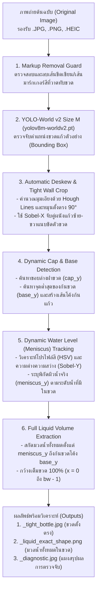

# เอกสารข้อกำหนดและสถาปัตยกรรมระบบตรวจจับขวดและสกัดมวลน้ำทั้งหมด (สิ่งที่ตรวจจับ)

เอกสารฉบับนี้ระบุรายละเอียดของระบบตรวจจับขวดตัวอย่างและสกัดมวลน้ำภายในขวด ตามความต้องการหลักของโปรเจกต์ เพื่อให้สามารถนำน้ำทั้งหมดที่มีอยู่ในขวดไปวิเคราะห์ค่าสีและทำนายความเข้มข้นทางเคมีได้อย่างแม่นยำครบทุกภาพ

---

## 1. เป้าหมายและสิ่งที่ต้องการให้ระบบตรวจจับ (Core Requirements)

### 1.1 สิ่งที่ต้องการสกัดออกมาจากภาพถ่าย
1. **การตรวจจับตัวขวด (Bottle Detection):**
   - ใช้โมเดล **YOLO-World ไซซ์ M (`yolov8m-worldv2.pt`)** ในการค้นหาตำแหน่งของขวดแก้วตัวอย่างทามกลางฉากหลังและแผ่นเทียบสี (Color Reference Card)
   - ปรับระนาบขวดที่อาจวางเอียงให้ตั้งตรง **90 องศา (Automatic Deskew)** และตัดขอบภาพให้แนบชิดผนังขวดซ้าย-ขวาและฝาถึงก้นขวดพอดี
2. **การดึงน้ำทั้งหมดที่มีอยู่ในขวด (Full Liquid Volume Extraction):**
   - **ขอบเขตด้านบน (Top Boundary):** เริ่มต้นที่ **ระดับผิวน้ำจริงในขวด (Water Level / Meniscus)** ตามปริมาณน้ำที่มีอยู่จริงในขวดแต่ละใบ
   - **ขอบเขตด้านล่าง (Bottom Boundary):** คลุมยาวลงมาจนสุดถึง **ก้นขวดแก้วด้านล่าง (Bottle Base / Curved Bottom)** ตามรูปทรงโค้งมนของก้นขวดจริง
   - **ขอบเขตด้านซ้ายและขวา (Left & Right Boundaries):** ดึงมวลน้ำ **เต็มความกว้างของขวด 100% (`x = 0` ถึง `bw - 1`)** จากผนังขวดด้านซ้ายจรดผนังขวดด้านขวาโดยไม่เว้นขอบข้างทิ้ง
   - **รูปทรงของมวลน้ำที่ได้:** เป็นทรงกระบอกของเหลวทั้งหมดที่บรรจุอยู่ในขวด (ตั้งแต่วงรีผิวน้ำด้านบน ผนังขวดซ้าย-ขวา ลงมาจนถึงส่วนโค้งของก้นขวดด้านล่างสุด)

### 1.2 กฎเหล็กของการทำงาน (Strict Design Rules)
- **ห้ามตั้งค่า Config ตายตัว (Zero Hardcoded Configuration):**
  - ห้ามกำหนดค่าพิกเซลตายตัว (เช่น ห้ามล็อกว่าผิวน้ำต้องอยู่ที่พิกเซลที่เท่าไหร่ หรือขวดต้องสูงกี่พิกเซล)
  - ห้ามตั้งค่าตัดขอบน้ำด้านข้างหรือบีบกรอบน้ำเข้าข้างในแบบคงที่
- **ต้องสามารถ Crop ได้ครบทุกภาพ 100% (Universal & Scale-Invariant):**
  - รองรับภาพถ่ายทุกความละเอียด (ไม่ว่าจะถ่ายใกล้หรือไกล ขนาดขวดเล็กหรือใหญ่)
  - รองรับปริมาณน้ำทุกระดับ (ไม่ว่าจะเติมน้ำครึ่งขวด ค่อนขวด หรือเกือบเต็มขวด)
  - รองรับทุกเฉดสีของสารละลาย (ตั้งแต่น้ำใสไม่มีสี 0 mg/L, สีเหลืองอ่อน, สีเขียว, สีน้ำเงินเข้ม ไปจนถึงสีเข้มทึบ)

---

## 2. แผนผังการทำงานของระบบตรวจจับ (Detection Pipeline Diagram)



---

## 3. รายละเอียดเชิงลึกของแต่ละขั้นตอนในโค้ด (`crop_bottle_and_liquid.py`)

### ขั้นตอนที่ 1: การลบเส้นขีดเขียนทับภาพ (`remove_drawn_markup`)
- **หน้าที่:** ป้องกันกรณีภาพตัวอย่างมีการวาดเส้นไกด์หรือขีดเส้นสี (เช่น เส้นสีม่วงหรือเส้นมาร์กเกอร์) ทับลงบนขวด
- **วิธีทำงาน:** แปลงภาพเป็นระบบสี HSV เพื่อตรวจหาพิกเซลของเส้นที่ขีดเขียน แล้วใช้อัลกอริทึม `cv2.inpaint` (Telea Method) เกลี่ยเนื้อภาพให้เนียนก่อนส่งเข้าโมเดลตรวจจับ

### ขั้นตอนที่ 2: การตรวจจับขวดด้วย YOLO-World ไซซ์ M (`locate_bottle`)
- **โมเดลที่ใช้:** `yolov8m-worldv2.pt` (รันบน GPU CUDA อัตโนมัติเมื่อพร้อมใช้งาน)
- **คำสั่งค้นหาวัตถุ (Classes):** `["glass bottle", "vial", "test tube", "medicine bottle"]`
- **กลไกคัดเลือกขวดอัตโนมัติ:**
  1. คัดกรองกล่องวัตถุที่อยู่ในบริเวณกลางภาพ (ไม่ไปจับขอบแผ่นเทียบสีด้านซ้าย-ขวา)
  2. คำนวณคะแนนความเหมาะสมจากความมั่นใจของโมเดล (Confidence), ขนาดพื้นที่, และระยะห่างจากจุดกึ่งกลางภาพ
  3. **Aspect Ratio Auto-Recovery:** หากกล่องที่ตรวจพบสั้นเกินไป (เช่น จับได้เฉพาะช่วงน้ำแต่ไม่คลุมฝาขวด) ระบบจะคำนวณสัดส่วนความกว้างต่อความสูงของขวดแล้วขยายขอบบนขึ้นไปคลุมฝาขวดให้อัตโนมัติ
  4. **Pure OpenCV Fallback:** หากภาพใดมีแสงสะท้อนรบกวนจน YOLO ไม่มั่นใจ ระบบมีกลไกสำรองด้วย Vertical/Horizontal Sobel Projection ค้นหาขวดให้ได้ 100% ทุกภาพ

### ขั้นตอนที่ 3: การหมุนขวดตั้งตรง 90 องศา และตัดขอบขวดแนบชิด (`deskew_and_tight_crop`)
- **การวัดมุมเอียง (Tilt Detection):**
  - ใช้ `cv2.Canny` ร่วมกับ `cv2.HoughLinesP` ตรวจหาเส้นตรงแนวตั้งของผนังขวดแก้ว
  - คำนวณค่ามัธยฐานของมุมเอียง (`tilt_deg`) และใช้ `cv2.warpAffine` หมุนภาพขวดให้ตั้งตรง 90 องศา
- **การล็อกผนังขวดซ้าย-ขวา (Cylinder Wall Pair Snapping):**
  - ใช้ Sobel Filter แนวนอน ($\partial I / \partial x$) สแกนหาความคมชัดของขอบผนังแก้วฝั่งซ้าย (`l_wall`) และฝั่งขวา (`r_wall`)
  - ตัดภาพให้แนบชิดกับผนังขวดด้านนอกพอดี โดยไม่ติดพื้นหลังหรือแผ่นเทียบสี
- **การล็อกขอบบนฝาขวดและขอบล่างก้นขวด:**
  - ใช้ Sobel Filter แนวตั้ง ($\partial I / \partial y$) ระบุขอบบนสุดของฝาขวด (`top_y`) และจุดสิ้นสุดของก้นขวดแก้ว (`bot_y`)

### ขั้นตอนที่ 4: การตรวจจับระดับผิวน้ำและก้นขวดแบบ Dynamic (`detect_water_level_and_segment`)
ระบบจะวิเคราะห์ภาพขวดที่ตั้งตรงแล้ว (`upright_bottle`) ขนาดความกว้าง `bw` และความสูง `bh` โดยไม่ใช้ค่าคงที่:

1. **การหาขอบล่างของฝาขวด (`cap_y`):**
   - สแกนหาจุดที่มีค่าการเปลี่ยนแปลงความเข้มแสงแนวตั้ง (Vertical Gradient Peak) สูงสุดในช่วงครึ่งบนของขวด เพื่อระบุรอยต่อระหว่างฝาสีขาวกับตัวหลอดแก้วใส
2. **การหาก้นขวดแก้ว (`base_y`):**
   - อ้างอิงจากตำแหน่งก้นขวดที่ตรวจพบ และค้นหาจุดเปลี่ยนผ่านของก้นแก้วด้านล่างสุด เพื่อให้ครอบคลุมน้ำจนถึงก้นขวดจริง
3. **การหาระดับผิวน้ำจริง (`meniscus_y`):**
   - วิเคราะห์ค่าความอิ่มตัวสี (Saturation - $S$) และความสว่าง (Value - $V$) ในระบบสี HSV ร่วมกับความชันของแสง (Sobel Gradient):
   - **กรณีน้ำมีสี (Colored Liquid):** สแกนลงมาจากใต้ฝาขวด (`cap_y`) เพื่อหาตำแหน่งแรกที่พ้นจากช่องว่างแก้วเปล่า (ซึ่งมีความอิ่มตัวสีต่ำและสว่าง) เข้าสู่เนื้อมวลน้ำที่มีสีจริง แล้วล็อกตำแหน่งผิวน้ำที่เส้นขอบหักเหสูงสุด (`row_g`) ณ จุดเปลี่ยนผ่านนั้น
   - **กรณีน้ำใส (Clear Liquid 0 mg/L):** สแกนหาจุดสูงสุดของเส้นหักเหแสงที่ผิวน้ำ (Meniscus Refraction Edge) ในช่วงหลอดแก้วโดยตรง

### ขั้นตอนที่ 5: การสกัดมวลน้ำทั้งหมดตั้งแต่ผิวน้ำจนถึงก้นขวด (Full Liquid Extraction)
- **ความกว้างแนวนอน:** กำหนด `x_left = 0` และ `x_right = bw - 1` เพื่อดึงน้ำเต็มความกว้างขวด 100%
- **ความสูงแนวตั้ง:** กำหนดตั้งแต่ระดับผิวน้ำ `pure_y1 = meniscus_y` ลงไปจนถึงก้นขวด `pure_y2 = base_y`
- **การจำลองส่วนโค้งก้นขวดตามจริง (`bot_curve`):**
  - สร้างสมการเส้นโค้งตามความกว้างขวด `bw` เพื่อโอบรับกับก้นขวดแก้วที่โค้งมนธรรมชาติ ทำให้ได้เนื้อน้ำครบถ้วนจนถึงก้นหลอดแก้วโดยไม่ติดมุมโต๊ะด้านนอกก้นขวด
- **การสร้าง Mask และบันทึกภาพ:**
  - วาดพื้นที่มวลน้ำทั้งหมดลงใน `liquid_mask` และรวมเข้ากับช่องสี `B, G, R` เป็นภาพ 4 ช่องสัญญาณ (RGBA) ขนาดครอบคลุมมวลน้ำทั้งหมดในขวด

---

## 4. ไฟล์ผลลัพธ์ที่ได้จากการตรวจจับ (Output Files)

เมื่อรันสคริปต์ [`crop_bottle_and_liquid.py`](file:///d:/my_girlfriend_work/crop_bottle_and_liquid.py) กับภาพเดี่ยวหรือทั้งโฟลเดอร์ ระบบจะสร้างไฟล์ผลลัพธ์ 3 ไฟล์ต่อ 1 รูปภาพ:

| ลำดับ | ชื่อไฟล์ผลลัพธ์ | รายละเอียดของไฟล์ |
| :---: | :--- | :--- |
| **1** | `<ชื่อภาพ>_tight_bottle.jpg` | ภาพขวดแก้วเต็มใบที่ผ่านการตรวจจับด้วย YOLO-World M หมุนปรับตั้งตรง 90 องศา และตัดขอบแนบชิดตัวขวด |
| **2** | `<ชื่อภาพ>_liquid_exact_shape.png` | **ภาพมวลน้ำทั้งหมดในขวด (ไฟล์หลักสำหรับนำไปวิเคราะห์)** ครอบคลุมตั้งแต่ผิวน้ำที่มีอยู่จนถึงก้นขวด เต็มความกว้างขวด 100% |
| **3** | `<ชื่อภาพ>_diagnostic.jpg` | ภาพแผงตรวจสอบการทำงาน แสดงเส้นระดับฝาขวด (`Cap Edge`), เส้นระดับผิวน้ำ (`Water Level`), เส้นก้นขวด (`Curved Base`), กรอบพื้นที่น้ำสีเขียว, ภาพมวลน้ำที่สกัดได้ และค่าสถิติ RGB/ขนาดพื้นที่ |

---

## 5. คำสั่งในการรันใช้งาน (Usage Commands)

### 5.1 รันตรวจจับและ Crop ภาพเดี่ยว
```bash
python crop_bottle_and_liquid.py "path/to/image.jpg" "output/crop_result"
```

### 5.2 รันตรวจจับและ Crop ทั้งโฟลเดอร์ (Batch Processing ทุกภาพอัตโนมัติ)
```bash
python crop_bottle_and_liquid.py "dataset_split" "dataset_cropped"
```

### 5.3 รันสกัดค่าสีจากมวลน้ำทั้งหมดและเทรนโมเดลวิเคราะห์ความเข้มข้น
```bash
python train_color_model.py
```
