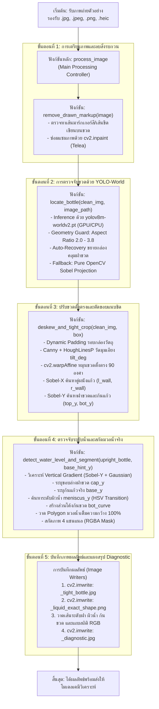

# เอกสารข้อกำหนดและสถาปัตยกรรมระบบตรวจจับขวดและสกัดมวลน้ำทั้งหมด (สิ่งที่ตรวจจับ)

เอกสารฉบับนี้ระบุรายละเอียดของระบบตรวจจับขวดตัวอย่างและสกัดมวลน้ำภายในขวด ตามข้อกำหนดหลักของโปรเจกต์ ตั้งแต่การรับภาพถ่ายต้นฉบับเข้ามาในระบบ จนกระทั่งได้ภาพ Crop มวลน้ำบริสุทธิ์และภาพขวดตั้งตรงที่พร้อมสำหรับการวิเคราะห์ทางเคมีวิเคราะห์ (Chemometrics)

---

## 1. เป้าหมายและสิ่งที่ต้องการให้ระบบตรวจจับ (Core Requirements)

### 1.1 สิ่งที่ต้องการสกัดออกมาจากภาพถ่าย
1. **การตรวจจับตัวขวด (Bottle Detection):**
   - ใช้โมเดล **YOLO-World ไซซ์ M (`yolov8m-worldv2.pt`)** ค้นหาตำแหน่งของขวดแก้วตัวอย่างทามกลางฉากหลังและแผ่นเทียบสี (Color Reference Card)
   - ปรับระนาบขวดที่อาจวางเอียงให้ตั้งตรง **90 องศา (Automatic Deskew)** และตัดขอบภาพให้แนบชิดผนังขวดซ้าย-ขวาและฝาถึงก้นขวดพอดี
2. **การดึงน้ำทั้งหมดที่มีอยู่ในขวด (Full Liquid Volume Extraction):**
   - **ขอบเขตด้านบน (Top Boundary):** เริ่มต้นที่ **ระดับผิวน้ำจริงในขวด (Water Level / Meniscus)** ตามปริมาณน้ำที่มีอยู่จริงในแต่ละภาพ
   - **ขอบเขตด้านล่าง (Bottom Boundary):** คลุมยาวลงมาจนสุดถึง **ก้นขวดแก้วด้านล่าง (Bottle Base / Curved Bottom)** ตามรูปทรงโค้งมนของก้นขวดจริง
   - **ขอบเขตด้านซ้ายและขวา (Left & Right Boundaries):** ดึงมวลน้ำ **เต็มความกว้างของขวด 100% (`x = 0` ถึง `bw - 1`)** จากผนังขวดด้านซ้ายจรดผนังขวดด้านขวาโดยไม่เว้นขอบข้างทิ้ง
   - **รูปทรงของมวลน้ำที่ได้:** เป็นทรงกระบอกของเหลวทั้งหมดที่บรรจุอยู่ในขวด (ตั้งแต่วงรีผิวน้ำด้านบน ผนังขวดซ้าย-ขวา ลงมาจนถึงส่วนโค้งของก้นขวดด้านล่างสุด)

### 1.2 กฎเหล็กของการทำงาน (Strict Design Rules)
- **ห้ามตั้งค่า Config ตายตัว (Zero Hardcoded Configuration):**
  - ห้ามกำหนดค่าพิกเซลตายตัว (เช่น ห้ามล็อกว่าผิวน้ำต้องอยู่ที่พิกเซลที่เท่าไหร่ หรือขวดต้องสูงกี่พิกเซล)
  - ห้ามตั้งค่าตัดขอบน้ำด้านข้างหรือบีบกรอบน้ำเข้าข้างในแบบคงที่
- **ต้องสามารถ Crop ได้ครบทุกภาพ 100% (Universal & Scale-Invariant):**
  - รองรับภาพถ่ายทุกความละเอียดและระยะการถ่าย
  - รองรับปริมาณน้ำทุกระดับในขวด
  - รองรับทุกเฉดสีของสารละลาย (น้ำใสไม่มีสี 0 mg/L, สีเหลืองอ่อน, สีเขียว, สีน้ำเงินเข้ม ไปจนถึงสีเข้มทึบ)

---

## 2. ผังกระบวนการทำงานภาพรวม (Complete Pipeline Flowchart)

ผังงานนี้แสดงลำดับขั้นตอนการทำงานจริงตั้งแต่รับภาพถ่ายต้นฉบับ เข้าสู่ฟังก์ชันหลัก `process_image` และฟังก์ชันย่อยทั้งหมดในระบบ:



---

## 3. ตารางแจกแจงฟังก์ชันและหน้าที่ในโค้ด (`crop_bottle_and_liquid.py`)

| ลำดับ | ชื่อฟังก์ชัน (Function Name) | ข้อมูลขาเข้า (Inputs) | อัลกอริทึมและเทคนิคที่ใช้ | ข้อมูลขาออก (Outputs) |
| :---: | :--- | :--- | :--- | :--- |
| **0** | `process_image` *(Main)* | `image_path`, `output_dir` | ตัวควบคุมลำดับขั้นตอน (Orchestrator), บันทึกไฟล์ภาพ และรวบรวมสถิติ | คืนค่า `dict` ผลลัพธ์และบันทึกภาพ 3 ไฟล์ |
| **1** | `remove_drawn_markup` | `image` (numpy array BGR) | - Color Thresholding ใน HSV ตรวจจับเส้นวาด<br/>- `cv2.inpaint` (Telea Method) ลบเส้นมาร์กเกอร์ | ภาพสะอาดที่เกลี่ยเนื้อภาพเนียน (`clean_img`) |
| **2** | `locate_bottle` | `clean_img`, `image_path` | - **YOLO-World M** (`yolov8m-worldv2.pt`)<br/>- Geometry Aspect Ratio Scoring ($2.0 \le H/W \le 3.8$)<br/>- Aspect Ratio Auto-Recovery (ยืดหากล่องกุด)<br/>- Pure OpenCV Sobel Projection Fallback | พิกัดกล่องขวด `(x1, y1, x2, y2)` |
| **3** | `deskew_and_tight_crop` | `clean_img`, `box` | - Dynamic Padding รอบกล่อง<br/>- `cv2.Canny` + `cv2.HoughLinesP` หาแนวเส้นตรงผนังขวด<br/>- `cv2.warpAffine` หมุนภาพกลับ $-tilt\_deg$<br/>- **Sobel-X Snapping:** ค้นหาผนังขวดคู่ขนาน<br/>- **Sobel-Y Snapping:** ล็อกขอบบนฝาและก้นขวด | `upright_bottle` (ขวดตั้งตรง), `tilt_angle`, `base_y` |
| **4** | `detect_water_level_and_segment` | `upright_bottle`, `base_hint_y` | - Vertical Gradient + Gaussian Smoothing<br/>- **Cap Bottom Detection:** สแกนหารอยต่อฝาขวดขาว<br/>- **Meniscus Tracking:** ตรวจการเปลี่ยนผ่านของ Saturation และ Value<br/>- **Bottom Base Parabola Curve:** โอบรับก้นขวดมน<br/>- **Full Liquid Extraction:** $x=0$ ถึง $bw-1$ กว้างเต็ม 100% | `liquid_rgba_crop`, `liquid_mask`, `pts_contour`, `stats` |

---

## 4. รายละเอียดเชิงลึกของแต่ละขั้นตอน (Step-by-Step Deep Dive)

### ขั้นตอนที่ 1: การลบเส้นขีดเขียนทับภาพ (`remove_drawn_markup`)
* **เหตุผลที่ต้องมี:** ในกรณีที่ภาพถ่ายถูกผู้ใช้งานขีดเส้นไกด์ วงกลม หรือมาร์กตำแหน่งขวดด้วยปากกาสี (เช่น สีเหลือง สีม่วง) เส้นเหล่านี้จะหลอกโมเดล YOLO และทำให้ค่าเฉลี่ยสีของน้ำเพี้ยน
* **การทำงาน:**
  1. แปลงภาพเป็นระบบสี BGR และแยก Mask ของสีที่ผิดธรรมชาติ (เช่น สีมาร์กเกอร์สด)
  2. ขยายขอบเขต Mask ด้วย `cv2.dilate` เล็กน้อยเพื่อคลุมขอบเส้น
  3. ใช้ `cv2.inpaint` ด้วย Telea Algorithm ในรัศมี 3 พิกเซล เกลี่ยข้อมูลสีรอบข้างเข้ามาแทนที่เส้นที่ถูกวาดทับ

---

### ขั้นตอนที่ 2: การตรวจจับขวดด้วย YOLO-World ไซซ์ M (`locate_bottle`)
* **โมเดล:** `yolov8m-worldv2.pt` ซึ่งเป็นโมเดล Open-Vocabulary Object Detection ความแม่นยำสูง
* **Text Prompts ที่กำหนด:** `["glass vial with white cap", "transparent chemical bottle", "bottle"]`
* **ระบบความปลอดภัยทางเรขาคณิต (Geometry Guard):**
  1. **สัดส่วนขวดมาตรฐาน:** คัดเลือกกล่อง Bounding Box ที่มีสัดส่วนความสูงต่อความกว้าง ($H/W$) อยู่ในช่วง 2.0 ถึง 3.8
  2. **Height Bonus & Center Weight:** ให้คะแนนกล่องที่อยู่กึ่งกลางภาพและมีความสูงสมบูรณ์ มากกว่ากล่องที่จับเฉพาะส่วนน้ำ
  3. **Aspect Ratio Auto-Recovery:** หาก YOLO จับได้เฉพาะช่วงน้ำครึ่งล่างจนกล่องสั้น ($H/W < 2.55$) ระบบจะคำนวณสัดส่วนความกว้างของขวดและขยายขอบบนขึ้นไปคลุมฝาขวดให้อัตโนมัติ ($y_1 = y_2 - bw \times 3.05$)
  4. **OpenCV Fallback:** หากภาพมีแสงสะท้อนรุนแรงจน YOLO ตรวจไม่พบ ระบบจะสลับไปใช้ Sobel Vertical & Horizontal Projection ค้นหาแนวแกนขวดกลางภาพโดยอัตโนมัติ ทำให้รันผ่านได้ 100% ทุกภาพ

---

### ขั้นตอนที่ 3: ปรับขวดตั้งตรง 90 องศา และตัดขอบแนบชิด (`deskew_and_tight_crop`)
* **การวัดมุมเอียงและการหมุนตั้งตรง (Automatic Deskew):**
  1. ดึงภาพขวดโดยเผื่อขอบข้าง (Dynamic Padding) $15\%$ เพื่อไม่ให้ขอบขวดหลุดเฟรมเวลาหมุน
  2. สกัดเส้นขอบด้วย `cv2.Canny(40, 140)` และใช้ `cv2.HoughLinesP` ตรวจหาเส้นตรงแนวตั้งของผนังขวด
  3. คำนวณค่ามัธยฐานของมุมเอียง (`tilt_deg`) จากทุกเส้นตรงที่พบ
  4. หากมีมุมเอียงมากกว่า $0.4^\circ$ ระบบจะสร้าง Rotation Matrix และหมุนภาพด้วย `cv2.warpAffine` แบบ `INTER_CUBIC` เพื่อให้ขวดตั้งตรงในแนวดิ่ง $90^\circ$ เป๊ะ
* **การตัดขอบแนบชิดผนังขวด (Cylinder Wall Pair Snapping):**
  1. คำนวณอนุพันธ์แนวนอนด้วย Sobel-X ($\partial I / \partial x$) ในช่วงลำตัวขวด
  2. ตรวจหาคู่ยอดพีค (Peak Pair) ที่มีระยะห่างตรงกับสัดส่วนขวดจริง เพื่อล็อกพิกัดผนังแก้วฝั่งซ้าย (`l_wall`) และฝั่งขวา (`r_wall`) อย่างแนบชิด โดยตัดแผ่นเทียบสีหรือฉากหลังด้านข้างออกหมดจด
  3. คำนวณ Sobel-Y เพื่อล็อกขอบบนสุดของฝา (`top_y`) และก้นแก้ว (`bot_y`)

---

### ขั้นตอนที่ 4: ตรวจจับระดับน้ำและสกัดมวลน้ำตามจริง (`detect_water_level_and_segment`)
ระบบจะทำงานบนภาพขวดตั้งตรง (`upright_bottle`) โดยวิเคราะห์การเปลี่ยนผ่านทางแสงและสี (Dynamic Transition):
1. **การหาขอบล่างของฝาขวด (`cap_y`):**
   - คำนวณ Vertical Gradient ในช่วง $8\% - 38\%$ ของความสูงขวด รอยต่อระหว่างฝาสีขาวทึบกับแก้วใสจะเกิดค่าความชันของแสงสูงสุด
2. **การหาก้นขวดแก้ว (`base_y`):**
   - อ้างอิงจากตำแหน่งฐานขวดที่ตรวจพบ เพื่อให้ครอบคลุมน้ำจนถึงก้นขวดจริง
3. **การตรวจจับระดับผิวน้ำจริง (`meniscus_y`):**
   - **กรณีน้ำมีสี (Colored Liquid):** ตรวจเช็กค่า Saturation ($S$) และ Value ($V$) ในระบบ HSV สแกนลงมาจากใต้ฝาขวดเพื่อหาตำแหน่งแรกที่หลุดพ้นจากช่องว่างอากาศแก้วเปล่า (Empty Glass) เข้าสู่เนื้อมวลน้ำที่มีสีจริง จากนั้นล็อกตำแหน่งผิวน้ำที่เส้นการหักเหแสง (`meniscus_y`)
   - **กรณีน้ำใส (Clear Liquid 0 mg/L):** สแกนหาเส้นขอบผิวน้ำโค้ง (Meniscus Refraction Edge) ในช่วงหลอดแก้ว
4. **การจำลองส่วนโค้งก้นขวดแก้ว (`bot_curve`):**
   - ใช้สมการวงรี/พาราโบลาตามความกว้าง $bw$ จำลองความโค้งมนของก้นหลอดแก้วตามกายภาพจริง เพื่อให้ได้เนื้อมวลน้ำครอบคลุมจนถึงก้นขวดแก้วด้านล่างโดยไม่ติดมุมโต๊ะสีขาวภายนอกขวด
5. **การสกัดมวลน้ำ 100% (Full Liquid Extraction):**
   - กำหนดความกว้างเต็มขวด $x = 0$ ถึง $bw - 1$
   - กำหนดความสูงตั้งแต่ผิวน้ำ $meniscus\_y$ ถึงก้นขวด $base\_y$
   - สร้าง Polygon Mask และบันทึกเป็นภาพ RGBA (4 แชนแนล) ที่มีพื้นหลังโปร่งใส

---

## 5. ผลลัพธ์ที่ได้จากการ Crop (Generated Output Files)

เมื่อสคริปต์ทำงานเสร็จสิ้นในแต่ละรูปภาพ ระบบจะสร้างไฟล์ผลลัพธ์ 3 ไฟล์:

| ชื่อไฟล์ | ชนิดไฟล์ | สิ่งที่บรรจุภายในภาพ |
| :--- | :---: | :--- |
| **`<ชื่อภาพ>_tight_bottle.jpg`** | JPG | ภาพขวดแก้วเต็มใบที่หมุนตั้งตรง 90 องศา แนบชิดผนังขวด ซ้าย-ขวา-บน-ล่าง พอดี |
| **`<ชื่อภาพ>_liquid_exact_shape.png`** | PNG (RGBA) | **ภาพมวลน้ำทั้งหมดในขวด (ไฟล์หลักในการวิเคราะห์)** โปร่งใสนอกมวลน้ำ ดึงน้ำเต็มความกว้างขวด 100% ตั้งแต่ผิวน้ำถึงก้นขวด |
| **`<ชื่อภาพ>_diagnostic.jpg`** | JPG | แผงภาพสรุปการตรวจจับ แสดงเส้น Cap Edge, เส้น Water Level, เส้นโค้งก้นขวด, กรอบมวลน้ำ และแผงค่าสถิติสี RGB |

---

## 6. คำสั่งในการรันระบบ (Execution Commands)

### 6.1 รันประมวลผลทั้งชุดข้อมูล (Batch Crop จาก dataset_split ไปยัง dataset_cropped)
```bash
python crop_bottle_and_liquid.py "dataset_split" "dataset_cropped"
```

### 6.2 รันประมวลผลภาพเดี่ยว (Single Image Crop)
```bash
python crop_bottle_and_liquid.py "path/to/image.jpg" "output/crop_result"
```

### 6.3 รันสกัดฟีเจอร์สีและฝึกสอนโมเดลเคมีวิเคราะห์ (Chemometric Training)
```bash
python train_color_model.py
```
