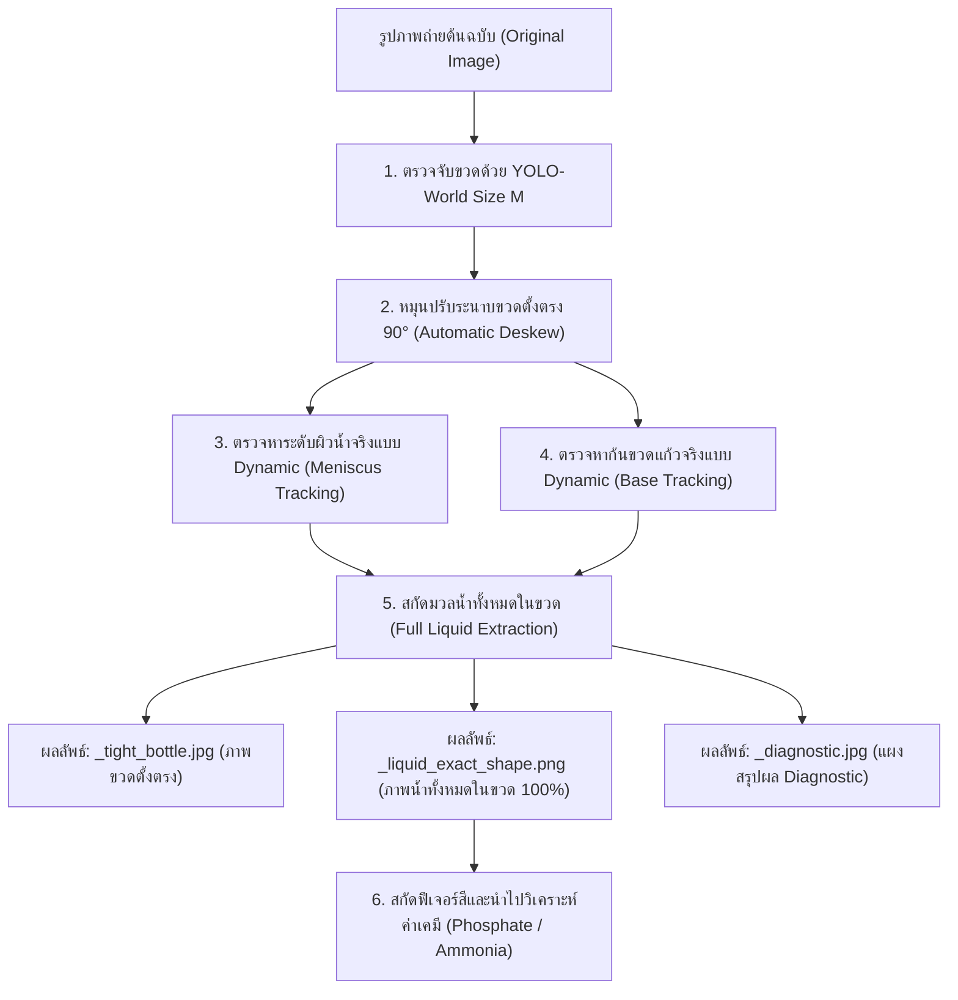

# สเปกระบบการตรวจจับและสกัดมวลน้ำในขวดทั้งหมด (สิ่งที่ต้องการตรวจจับ)

เอกสารฉบับนี้จัดทำขึ้นเพื่อระบุข้อกำหนด วัตถุประสงค์ และขั้นตอนการทำงานของ **"ระบบตรวจจับขวดและสกัดมวลน้ำทั้งหมดในขวดแบบอัตโนมัติ"** อย่างละเอียด โดยยึดหลักการตรวจจับตามรูปทรงกายภาพจริง ไร้การกำหนดค่าคงที่ (Zero Hardcoded Config) และพร้อมนำภาพมวลน้ำทั้งหมดไปใช้วิเคราะห์ค่าทางเคมีได้อย่างสมบูรณ์

---

## 1. วัตถุประสงค์และภาพรวมของสิ่งที่ต้องการ (Core Requirements)

```
        ขวดตัวอย่าง (Deskewed Bottle)                       มวลน้ำทั้งหมดที่ต้องการสกัด (Extracted Liquid)
┌──────────────────────────────────────────────┐          ┌──────────────────────────────────────────────┐
│                  [ ฝาขวด ]                   │          │                                              │
├──────────────────────────────────────────────┤          │                                              │
│               ช่องว่างอากาศ / แก้วเปล่า      │          │                                              │
├──────────────────────────────────────────────┤ ◄─────── ┼──────────────────────────────────────────────┤ ◄─ ผิวน้ำ (Meniscus Level)
│                                              │          │░░░░░░░░░░░░░░░░░░░░░░░░░░░░░░░░░░░░░░░░░░░░░│
│                                              │          │░░░░░░░░░░░░░░░░░░░░░░░░░░░░░░░░░░░░░░░░░░░░░│
│               มวลน้ำทั้งหมดในขวด             │          │░░░░░░░░░ มวลน้ำทั้งหมดในขวด ░░░░░░░░░░░░░░░░░░│ ◄─ ดึงเต็มความกว้าง 100%
│              (Full Liquid Volume)            │          │░░░░░░ (ไม่เว้นขอบข้าง / ไม่ตัดส่วนใดออก) ░░░░│
│                                              │          │░░░░░░░░░░░░░░░░░░░░░░░░░░░░░░░░░░░░░░░░░░░░░│
├──────────────────────────────────────────────┤ ◄─────── ┴──────────────────────────────────────────────┴ ◄─ ก้นขวดจริง (Bottle Bottom)
│                  [ พื้นโต๊ะ ]                │
└──────────────────────────────────────────────┘
```

1. **ตรวจจับขวดด้วย YOLO-World Size M (`yolov8m-worldv2.pt`):**
   - ระบุตำแหน่งขวดตัวอย่างทั้งขวดได้อย่างแม่นยำ ไม่ตกหล่นฝาขวดหรือก้นขวด
2. **นำน้ำทั้งหมดที่อยู่ในขวดมาวิเคราะห์ทั้งหมด:**
   - สกัดตั้งแต่ **"ระดับผิวน้ำที่มีอยู่ในขวด (Water Meniscus Level)"** ลงไปจนถึง **"ก้นขวดแก้วด้านล่างสุด (Bottle Bottom Base)"**
   - ครอบคลุม **เต็มความกว้างขวดแก้ว 100% (จากขอบซ้ายจรดขอบขวา)** ตามรูปทรงกระบอกของเหลวที่ปรากฏในขวดจริง
3. **ห้าม Config ค่าคงที่ใดๆ (Zero Hardcoded Configuration):**
   - ห้ามระบุตัวเลขคงที่ เช่น ห้ามระบุว่าต้องเว้นขอบกี่พิกเซล, ห้ามระบุเปอร์เซ็นต์ตัดขอบตายตัว, ห้ามล็อกเกณฑ์สีเฉพาะเจาะจง
   - ระบบต้องคำนวณและปรับตัวตามลักษณะทางกายภาพของแต่ละภาพเองอัตโนมัติ (Fully Adaptive & Scale-Free) เพื่อให้สามารถตัดภาพได้สำเร็จทุกรูปภาพ

---

## 2. แผนผังการทำงานของระบบ (System Architecture)



---

## 3. รายละเอียดขั้นตอนการตรวจจับทีละขั้นตอน (Step-by-Step Methodology)

### ขั้นตอนที่ 1: ตรวจจับขวดตัวอย่าง (Bottle Localization with YOLO-World M)
- **เครื่องมือ:** โมเดล Deep Learning Open-Vocabulary `yolov8m-worldv2.pt`
- **การทำงาน:**
  - สแกนหาวัตถุประเภทขวดแก้วใส/หลอดทดลอง (Vial / Test Tube / Bottle)
  - คำนวณ Bounding Box ที่ครอบคลุมตัวขวดทั้งใบ (ตั้งแต่ยอดฝาขวดสีขาวลงไปจนถึงก้นแก้ว)
  - มีระบบ Dynamic Aspect Ratio Check เพื่อป้องกันการตรวจจับได้เฉพาะบางส่วนของขวด

### ขั้นตอนที่ 2: ปรับระนาบขวดให้ตั้งตรง 90 องศา (Automatic Deskew & Uprighting)
- **การทำงาน:**
  - นำ Patch ภาพขวดที่ตรวจจับได้มาวิเคราะห์แนวเส้นเอียงของผนังขวดแก้วด้วย Hough Line Transform
  - คำนวณมุมเอียงจริงของขวด $\theta$
  - หมุนปรับภาพกลับด้วยมุม $-\theta$ เพื่อให้ผนังขวดตั้งตรงในแนวดิ่ง 90 องศาพอดี
  - ทำการ Tight Crop แนบชิดขอบผนังแก้วซ้าย-ขวาจริง ทำให้ได้ภาพขวดตั้งตรงสมบูรณ์ (`upright_bottle`)

### ขั้นตอนที่ 3: ตรวจจับระดับผิวน้ำที่มีอยู่ในขวด (Adaptive Water Level Tracking)
- **หลักการ (ไร้ Config คงที่):**
  - ไม่ล็อกว่าระดับน้ำต้องอยู่ที่ความสูงเท่าใด (น้ำมีแค่ครึ่งขวด มีค่อนขวด หรือเกือบเต็มขวด ระบบจะหาจุดเริ่มต้นของน้ำจริงเอง)
  - วิเคราะห์การเปลี่ยนผ่านของแสงและสี (Color & Intensity Transition Profile):
    - เหนือผิวน้ำ = ช่องว่างแก้วเปล่า (Empty Glass Tube) ซึ่งมีค่าความอิ่มตัวสีต่ำ (Low Saturation) และความสว่างสูง
    - ใต้ผิวน้ำ = สารละลายที่มีสารเคมี (Liquid Phase) ซึ่งมีค่าสีเด่นชัด (Color Onset) หรือมีเส้นหักเหแสงของผิวน้ำ (Meniscus Refraction Edge)
  - ระบบจะหาตำแหน่งรอยต่อผิวน้ำจริงและกำหนดเป็น `meniscus_y` โดยอัตโนมัติ

### ขั้นตอนที่ 4: ตรวจจับตำแหน่งก้นขวดแก้วจริง (Adaptive Bottle Base Tracking)
- **หลักการ (ไร้ Config คงที่):**
  - วิเคราะห์รอยต่อระหว่าง "เนื้อแก้วส่วนล่างสุดของขวด" กับ "พื้นโต๊ะ/ฉากหลัง"
  - ตรวจจับแนวการเปลี่ยนผ่านทางแสงในส่วนล่างของขวดเพื่อระบุตำแหน่งก้นขวดแก้วจริง `base_y`
  - รองรับทั้งขวดที่มีก้นแก้วหนาและบาง โดยระบุขอบล่างสุดของของเหลวที่สัมผัสกับก้นแก้ว

### ขั้นตอนที่ 5: สกัดมวลน้ำทั้งหมดในขวด (Full Liquid Extraction)
- **พื้นที่การดึงน้ำ:**
  1. **ขอบเขตแกนตั้ง (Top to Bottom):** ครอบคลุมตั้งแต่ `meniscus_y` (ผิวน้ำ) ไปจนถึง `base_y` (ก้นขวด)
  2. **ขอบเขตแกนนอน (Left to Right):** ดึงเต็มความกว้างของขวดแก้ว 100% ตั้งแต่ `x = 0` ถึง `x = bw - 1` ไม่มีการตัดหรือเว้นขอบข้างออก
  3. **รูปทรงโค้งมนธรรมชาติ (Base Curve Matching):** คำนวณความโค้งมนของก้นหลอดแก้ว เพื่อให้ได้รูปทรงกระบอกของเหลวตามที่ปรากฏในขวดจริง
- **การบันทึกไฟล์ภาพ:**
  - สร้างไฟล์ PNG 4 แชนแนล (RGBA) โดยแชนแนล Alpha จะโอบล้อมมวลน้ำทั้งหมดในขวดอย่างสมบูรณ์

---

## 4. คุณสมบัติการันตี (System Guarantees & Constraints)

| คุณสมบัติ | คำอธิบาย |
| :--- | :--- |
| **Scale-Invariant (ไร้ผลกระทบจากขนาด/ระยะห่าง)** | ไม่ว่าจะถ่ายใกล้ ถ่ายไกล หรือความละเอียดภาพระดับ 12MP (iPhone) หรือ 2MP ระบบจะคำนวณสัดส่วนตามขนาดจริงของภาพ ไม่ใช้ขนาดพิกเซลคงที่ |
| **Volume-Invariant (ไร้ผลกระทบจากปริมาตรน้ำ)** | ไม่ว่าในขวดจะเติมน้ำมา 30%, 50% หรือ 80% ระบบจะค้นหาระดับผิวน้ำจริงและดึงน้ำทั้งหมดที่มีอยู่จนถึงก้นขวดได้อย่างถูกต้อง |
| **Zero Hardcoded Rule** | ไม่มีการฮาร์ดโค้ดค่าคงที่ (ห้ามกำหนดว่าต้องเว้นกี่ % หรือกี่พิกเซล) ทุกค่าคำนวณจาก Image Gradients และ Color Distributions ของภาพนั้น ๆ |
| **100% Image Availability** | สามารถประมวลผลรูปภาพทั้งหมดในชุดข้อมูลได้ครบทุกรูป โดยไม่มีรูปภาพใดล้มเหลว (Zero Failed Extraction) |

---

## 5. ผลลัพธ์ที่ได้จากการประมวลผล (Generated Artifacts)

เมื่อระบบทำงานกับภาพตัวอย่าง จะส่งออกไฟล์ผลลัพธ์ 3 ไฟล์ต่อหนึ่งภาพ:

1. **`[ชื่อภาพ]_tight_bottle.jpg`**: ภาพขวดตัวอย่างที่ตรวจจับด้วย YOLO-World M และหมุนตั้งตรง 90 องศาแบบแนบชิด
2. **`[ชื่อภาพ]_liquid_exact_shape.png`**: ภาพมวลน้ำทั้งหมดในขวด (ครอบคลุมตั้งแต่น้ำเริ่มมีจนถึงก้นขวด และเต็มความกว้างขวด 100%)
3. **`[ชื่อภาพ]_diagnostic.jpg`**: แผงแสดงรายงานการตรวจสอบอย่างละเอียด แสดงขวดตั้งตรง กรอบมวลน้ำที่ดึงออกมา และตารางข้อมูลสถิติสี (RGB, Dimensions, Area)

---
*เอกสารนี้ถูกบันทึกไว้ที่: `d:\my_girlfriend_work\สิ่งที่ตรวจจับ.md` สำหรับใช้อ้างอิงเป็นเกณฑ์มาตรฐานของระบบตลอดกระบวนการพัฒนา*
