# เอกสารคู่มือกระบวนการ สถาปัตยกรรมระบบ และวิธีทำ (สิ่งที่ทำ)

เอกสารฉบับนี้สรุปภาพรวมทางเทคนิค สถาปัตยกรรมระบบคอมพิวเตอร์วิทัศน์ (Computer Vision Pipeline) และ **"วิธีทำทีละขั้นตอน (Step-by-Step Guide)"** สำหรับการตรวจจับขวดตัวอย่างสารเคมี หมุนปรับระนาบตั้งตรง ตรวจจับระดับผิวน้ำ กรองแสงสะท้อนสีขาว (White Glare & Table Reflection) จนได้เนื้อมวลน้ำบริสุทธิ์ (Pure Liquid Extraction) เพื่อนำไปวิเคราะห์ความเข้มข้นสารเคมี (Chemometrics) ได้อย่างแม่นยำสูงสุด 100%

---

## 1. วัตถุประสงค์และข้อกำหนดหลักของระบบ (Core Requirements)

### 1.1 สิ่งที่ระบบต้องทำให้สำเร็จ
1. **การตรวจจับตัวขวด (Bottle Detection & Automatic Deskew):**
   - ใช้โมเดล **YOLO-World ไซซ์ M (`yolov8m-worldv2.pt`)** ตรวจจับตำแหน่งขวดแก้วตัวอย่างท่ามกลางฉากหลังและแผ่นเทียบสี
   - ปรับระนาบขวดที่เอียงให้ตั้งตรง **90 องศา แนวดิ่ง (Automatic Deskew)** ด้วย Hough Line Transform
   - ตัดขอบภาพแนบชิดผนังขวดซ้าย-ขวา (`Sobel-X Snapping`) และขอบฝาถึงก้นขวด (`Sobel-Y Snapping`)
2. **การตรวจจับระดับผิวน้ำที่แท้จริง (Universal Meniscus Detection):**
   - **สารละลายมีสี (Colored Solutions เช่น Ammonia เขียว/เหลือง, Phosphate น้ำเงิน):** ติดตามรอยต่อระหว่างช่องว่างแก้วเปล่าใต้ฝากับเนื้อมวลน้ำที่มีสีจริงด้วย HSV Transitions
   - **สารละลายใสไม่มีสี (Clear Solutions เช่น Phosphate 0 mg/L):** ตรวจจับเส้นโค้งการหักเหแสงใต้ขอบฝาขวด (Sub-cap Meniscus Refraction Edge) ที่ระยะ `cap_y + 8` px ทำให้ได้มวลน้ำเต็มหลอดจริง **~66.4% - 68.0%** ของตัวขวด ไม่หลุดไปตัดทิ้งกลางหลอด
3. **การกรองแสงสะท้อนอัจฉริยะ (Smart White Glare & Table Reflection Filter):**
   - กำจัดแสงสะท้อนผิวน้ำโค้งด้านบน (Meniscus glare) และแสงสะท้อนพื้นโต๊ะทะลุก้นแก้ว (Table caustics) ด้วยระบบสี HSV Decoupling (ความสว่าง Value + ความสด Saturation)
   - สารละลายมีสี: ตัดบริเวณที่แสงสะท้อนจัดและไร้สี `(Value > 140 & Saturation < 45)`
   - สารละลายใส: ตัดเฉพาะจุดแสงสะท้อนจ้าผิดปกติด้วย Adaptive Threshold โดยไม่ทำลายเนื้อมวลน้ำใส
   - ให้ผลลัพธ์เป็นภาพโปร่งใส (`Alpha = 0`) บริเวณแสงสะท้อน เหลือเฉพาะเนื้อมวลของเหลวแท้จริง 100%

### 1.2 กฎเหล็กของการออกแบบ (Strict Universal Rules)
- **Zero Hardcoded Configuration:** ห้ามกำหนดค่าพิกเซลตายตัว ห้ามล็อกความสูงขวดหรือขอบเขตน้ำเป็นตัวเลขคงที่
- **Dynamic & Scale-Invariant:** ทำงานได้กับภาพถ่ายทุกความละเอียด ทุกระยะกล้อง และทุกอุปกรณ์ (กล้องมือถือ, แท็บเล็ต)

---

## 2. ผังกระบวนการทำงานภาพรวม (Complete Pipeline Flowchart)

```mermaid
flowchart TD
    Start["เริ่มต้น: รับภาพถ่ายตัวอย่าง<br/>(.jpg, .jpeg, .png, .heic)"] --> F_Main["ฟังก์ชันหลัก: process_image<br/>(Main Pipeline Controller)"]
    
    subgraph Step1["ขั้นตอนที่ 1: เตรียมภาพและลบสิ่งรบกวน"]
        F_Main --> F1["ฟังก์ชัน: remove_drawn_markup(image)<br/>- ค้นหาเส้นวาดมาร์กเกอร์/สีขีดเขียนบนภาพ<br/>- ซ่อมแซมเนื้อภาพด้วย cv2.inpaint (Telea Method)"]
    end

    subgraph Step2["ขั้นตอนที่ 2: ตรวจจับขวดด้วย YOLO-World ไซซ์ M"]
        F1 --> F2["ฟังก์ชัน: locate_bottle(clean_img, image_path)<br/>- รัน Inference ด้วย yolov8m-worldv2.pt บน GPU<br/>- กรองสัดส่วนความปลอดภัย: Aspect Ratio 2.0 - 3.8<br/>- Auto-Recovery ขยายกล่องคลุมฝาขวดอัตโนมัติ<br/>- Fallback: Pure OpenCV Sobel Projection"]
    end

    subgraph Step3["ขั้นตอนที่ 3: หมุนตั้งตรง 90 องศา และตัดขอบแนบชิด"]
        F2 --> F3["ฟังก์ชัน: deskew_and_tight_crop(clean_img, box)<br/>- Dynamic Margin เผื่อขอบ 15% รอบกล่อง<br/>- Canny + HoughLinesP วัดมุมเอียง tilt_deg<br/>- cv2.warpAffine หมุนขวดตั้งตรง 90 องศาในแนวดิ่ง<br/>- Sobel-X ค้นหาผนังแก้วคู่ขนาน (l_wall, r_wall)<br/>- Sobel-Y ค้นหาขอบฝาและก้นแก้ว (top_y, bot_y)"]
    end

    subgraph Step4["ขั้นตอนที่ 4: ตรวจจับระดับน้ำและสกัดมวลน้ำบริสุทธิ์"]
        F3 --> F4["ฟังก์ชัน: detect_water_level_and_segment(upright_bottle, base_hint_y)<br/>- วิเคราะห์ Vertical Gradient (Sobel-Y + Gaussian)<br/>- ระบุขอบล่างฝาขวดขาว cap_y และก้นขวดโค้ง base_y<br/>- ตรวจจับระดับผิวน้ำ meniscus_y (แยกทางน้ำมีสี vs น้ำใสใต้ฝา)<br/>- จำลองส่วนโค้งก้นขวดมน bot_curve ด้วยพาราโบลา<br/>- สร้างหน้ากาก liquid_mask เต็มความกว้าง 100%"]
        
        F4 --> F4_Filter["Smart White Glare Filter (HSV Decoupling)<br/>- น้ำมีสี: ตัด (Val > 140 & Sat < 45)<br/>- น้ำใส: Adaptive Cut แสงสะท้อนจ้าผิดปกติ<br/>- กำจัดแสงสะท้อนผิวน้ำบนและแสงสะท้อนโต๊ะก้นแก้ว<br/>- สกัดภาพ 4 แชนแนล (RGBA Pure Liquid Mask)"]
    end

    subgraph Step5["ขั้นตอนที่ 5: บันทึกผลลัพธ์และแผงสรุป Diagnostic"]
        F4_Filter --> F5["การบันทึกภาพผลลัพธ์ (Image Writers)<br/>1. _tight_bottle.jpg: ขวดตั้งตรงแนบชิด<br/>2. _liquid_exact_shape.png: มวลน้ำบริสุทธิ์โปร่งใส (Alpha=0 จุดสะท้อน)<br/>3. _diagnostic.jpg: แผงวิเคราะห์มุมเอียง ระดับน้ำ และสถิติสี RGB"]
    end

    F5 --> End["สิ้นสุดกระบวนการ: ได้ข้อมูลพร้อมส่งให้โมเดล Chemometrics"]
```



---

## 3. ตารางแจกแจงฟังก์ชันและอัลกอริทึม (`crop_bottle_and_liquid.py`)

| ลำดับ | ชื่อฟังก์ชัน (Function Name) | ข้อมูลขาเข้า (Inputs) | อัลกอริทึมและตรรกะการประมวลผล | ข้อมูลขาออก (Outputs) |
| :---: | :--- | :--- | :--- | :--- |
| **0** | `process_image` *(Main)* | `image_path`, `output_dir` | ควบคุม Pipeline ทั้งหมด จัดการ I/O บันทึกไฟล์ และสรุปสถิติ | `dict` ผลลัพธ์และไฟล์ 3 ชนิด |
| **1** | `remove_drawn_markup` | `image` (BGR) | HSV Thresholding ตรวจหาสีปากกามาร์กเกอร์สด และเกลี่ยเนื้อภาพด้วย `cv2.inpaint` (Telea) | `clean_img` (ภาพสะอาด) |
| **2** | `locate_bottle` | `clean_img`, `image_path` | YOLO-World M (`yolov8m-worldv2.pt`) + Geometry Aspect Ratio Guard ($2.0 \le H/W \le 3.8$) + Auto-Recovery ขยายหากล่องสั้น | พิกัดกล่องขวด `(x1, y1, x2, y2)` |
| **3** | `deskew_and_tight_crop` | `clean_img`, `box` | `Canny` + `HoughLinesP` วัดมุมเอียงของผนังขวด, หมุนตั้งตรงด้วย `cv2.warpAffine`, ล็อกผนังแก้วด้วย `Sobel-X` และล็อกฝา/ก้นขวดด้วย `Sobel-Y` | `upright_bottle`, `tilt_angle`, `base_y` |
| **4** | `detect_water_level_and_segment` | `upright_bottle`, `base_hint_y` | - **Cap Detection:** จุดรอยต่อฝาขาวกับแก้วใส<br/>- **Sub-cap Meniscus:** สแกนหาผิวน้ำที่ `cap_y + 8` (ครอบคลุมทั้งน้ำสีและน้ำใส)<br/>- **Parabola Bottom Base:** โค้งรับก้นแก้วจริง<br/>- **Smart Glare Filter:** ตัดแสงสะท้อนบน-ล่างด้วย HSV (Val + Sat) | `liquid_rgba` (มวลน้ำเพียวโปร่งใส), `liquid_mask`, `stats` |

---

## 4. รายละเอียดเชิงลึกของวิธีทำแต่ละขั้นตอน (Technical Methodology)

### ขั้นตอนที่ 1: การลบเส้นขีดเขียนสิ่งรบกวน (`remove_drawn_markup`)
- **ปัญหาที่พบ:** มีภาพถ่ายตัวอย่างบางภาพที่ผู้ใช้งานใช้ปากกามาร์กเกอร์สีสดขีดเส้นบอกระดับน้ำหรือวงกลมไว้บนขวด ทำให้โมเดล AI สับสนและดึงค่าสีผิด
- **วิธีแก้:** ตรวจจับแบนด์สีสังเคราะห์ในระบบ HSV จากนั้นใช้ `cv2.inpaint` โหมด Telea ในรัศมี 3 พิกเซล จำลองเกลี่ยพื้นหลังเดิมเข้ามาแทนที่ ทำให้ภาพขวดกลับมาสะอาดเหมือนเดิม

### ขั้นตอนที่ 2: การตรวจจับขวดด้วย YOLO-World M (`locate_bottle`)
- **โมเดล:** `yolov8m-worldv2.pt` ใช้ Text Prompts: `"glass vial with white cap", "transparent chemical bottle", "bottle"`
- **Geometry Guard:** คัดเลือกกล่องที่มีสัดส่วนความสูงต่อความกว้าง ($H/W$) อยู่ระหว่าง $2.0 - 3.8$ 
- **Auto-Recovery:** หากตรวจจับได้เฉพาะช่วงน้ำ ($H/W < 2.55$) ระบบจะคำนวณสัดส่วนความกว้าง $bw$ และขยายขอบบนขึ้นไปคลุมฝาขวดอัตโนมัติ ($y_1 = y_2 - bw \times 3.05$)
- **Fallback:** กรณีแสงสะท้อนรุนแรงจน YOLO ไม่พบกล่อง ระบบจะสลับไปใช้ Sobel Vertical & Horizontal Projection อัตโนมัติ ทำให้รันผ่านได้ 100% ทุกภาพ

### ขั้นตอนที่ 3: หมุนปรับระนาบตั้งตรง 90 องศา (`deskew_and_tight_crop`)
1. เผื่อขอบภาพ $15\%$ (Dynamic Margin) เพื่อไม่ให้มุมขวดหลุดเฟรมเวลาหมุน
2. ใช้ `cv2.Canny` ร่วมกับ `cv2.HoughLinesP` ตรวจจับเส้นตรงแนวดิ่งของผนังขวดทั้งสองข้าง
3. คำนวณมุมเอียงมัธยฐาน (`tilt_angle`) และหมุนภาพกลับด้วย `cv2.warpAffine` แบบ `INTER_CUBIC`
4. ใช้ **Sobel-X Peak Pair Snapping** ล็อกตำแหน่งผนังแก้วซ้าย (`l_wall`) และขวา (`r_wall`) แนบชิดกับเนื้อแก้วจริง ตัดแผ่นเทียบสีหรือฉากหลังภายนอกออกหมดจด

### ขั้นตอนที่ 4: ตรวจจับระดับผิวน้ำและกรองแสงสะท้อน (`detect_water_level_and_segment`)
1. **การหาขอบฝาขวด (`cap_y`):** วิเคราะห์ความชันของแสงแนวดิ่ง (Vertical Sobel-Y Gradient) ในช่วง $8\% - 38\%$ รอยต่อระหว่างฝาสีขาวทึบกับแก้วใสจะเกิดยอดพีคชัดเจน
2. **การตรวจจับระดับผิวน้ำ (`meniscus_y`):**
   - **กรณีน้ำมีสี:** สแกนค่า Saturation และ Value หาจุดแรกที่ก้าวข้ามจากช่องว่างแก้วเปล่าใต้ฝาเข้าสู่มวลน้ำสี
   - **กรณีน้ำใส (Phosphate 0 mg/L):** สแกนหาเส้น Meniscus Refraction Edge บริเวณใต้ขอบฝาขวดทันที (`search_start = cap_y + 8` ถึง `cap_y + 0.55 * column`) ซึ่งเป็นตำแหน่งที่แสงไฟสะท้อนขอบผิวน้ำโค้ง ทำให้ได้มวลน้ำเต็มคอลัมน์ ~68%
3. **การจำลองความโค้งมนของก้นขวด (`bot_curve`):** ใช้สมการพาราโบลาตามขนาดความกว้าง $bw$ โอบรับก้นหลอดแก้วตามกายภาพจริง
4. **ตัวกรองแสงสะท้อนอัจฉริยะ (Smart White Glare Filter):**
   - แสงสะท้อนผิวน้ำด้านบนและแสงสะท้อนโต๊ะก้นแก้วมีคุณสมบัติร่วมกันคือ: **สว่างจัด (Value สูง) แต่ซีดจืดไร้สี (Saturation ต่ำ)**
   - สารละลายมีสี: กรองพิกเซลที่ `(Value > 140) & (Saturation < 45)` ให้เป็นค่าโปร่งใส (`Alpha = 0`)
   - น้ำใสไม่มีสี: ใช้วิธี Adaptive Cut `(Value > max(215, med_val + 20)) & (Saturation < 25)` ตัดเฉพาะจุดสะท้อนจ้า โดยคงเนื้อมวลน้ำใสไว้ครบ 100%

---

## 5. ผลลัพธ์ที่ได้จากการประมวลผล (Generated Output Files)

ทุกภาพที่ผ่านระบบจะได้รับไฟล์ผลลัพธ์ 3 ไฟล์:

| ชื่อไฟล์ผลลัพธ์ | ชนิดไฟล์ | ประโยชน์และการนำไปใช้งาน |
| :--- | :---: | :--- |
| **`[ชื่อภาพ]_tight_bottle.jpg`** | JPG | ภาพขวดแก้วเต็มใบที่หมุนตั้งตรง 90 องศา แนบชิดขอบผนังขวดและฝา-ก้นขวดพอดี |
| **`[ชื่อภาพ]_liquid_exact_shape.png`** | PNG (RGBA) | **ไฟล์หัวใจหลักสำหรับการวิเคราะห์ทางเคมี:** มวลน้ำทรงจริงที่ตัดแสงสะท้อนบน-ล่างออกจนโปร่งใส (`Alpha = 0`) เหลือเฉพาะเนื้อมวลน้ำบริสุทธิ์ |
| **`[ชื่อภาพ]_diagnostic.jpg`** | JPG | แผงสรุปภาพวิเคราะห์ 3 ส่วน: ภาพขวดตรงพร้อมเส้นกำกับ, ภาพมวลน้ำเพียว, และแผงรายงานตัวเลขอัตราส่วนความจุ, จำนวนพิกเซลที่กรองแสงออก, และค่าเฉลี่ยสี RGB |

---

## 6. คู่มือวิธีทำและวิธีรันระบบจริง (Step-by-Step Practical Execution Guide)

### 6.1 ตรวจสอบสภาพแวดล้อมก่อนเริ่มทำงาน
เปิด Terminal ในโฟลเดอร์โปรเจกต์ `d:\my_girlfriend_work`:
```powershell
# 1. ตรวจสอบการใช้งาน GPU / CUDA
python -c "import torch; print('CUDA Available:', torch.cuda.is_available(), 'Device:', torch.cuda.get_device_name(0) if torch.cuda.is_available() else 'CPU')"

# 2. ตรวจสอบการเชื่อมต่อโมเดล YOLO-World M
python -c "import os; print('YOLO Model Ready:', os.path.isfile('models/yolov8m-worldv2.pt'))"
```

---

### 6.2 วิธีรัน Crop รูปภาพเดี่ยว (Single Image Crop)
เหมาะสำหรับทดสอบภาพตัวอย่างใหม่ หรือตรวจสอบรูปภาพที่ต้องการเจาะจง:
```powershell
python crop_bottle_and_liquid.py "พาธของไฟล์รูปภาพ" [โฟลเดอร์บันทึกผลลัพธ์]
```

**ตัวอย่างคำสั่งที่ใช้บ่อย:**
```powershell
# 1. รันรูปภาพในโฟลเดอร์ that_i_want_to_crop
python crop_bottle_and_liquid.py "that_i_want_to_crop\20250729_141617.jpg" "output\crop_result"

# 2. รันรูปน้ำใส Phosphate 0 mg/L
python crop_bottle_and_liquid.py "Testkit for AI\Phosphate 0 mg_l\0227CBA5-2BC6-4B6A-A86A-B124583E29DD.JPEG" "output\crop_result"

# 3. รันรูปสารละลายสี Ammonia 5 mg/L
python crop_bottle_and_liquid.py "Testkit for AI\Ammonia 5 mg_l\Ammonia 5 mg_l_01.jpeg" "output\crop_result"
```

---

### 6.3 วิธีรัน Crop ทั้งโฟลเดอร์แบบชุดข้อมูล (Batch Crop Processing)
ระบบจะค้นหาไฟล์ภาพทุกประเภท (`.jpg`, `.jpeg`, `.png`, `.webp`) ในโฟลเดอร์ย่อยทั้งหมดแบบ Recursive Search และจัดหมวดหมู่ปลายทางให้อัตโนมัติ:
```powershell
python crop_bottle_and_liquid.py "พาธของโฟลเดอร์ต้นทาง" [โฟลเดอร์บันทึกผลลัพธ์]
```

**ตัวอย่างคำสั่งที่ใช้บ่อย:**
```powershell
# 1. รันชุดข้อมูล Test Set (dataset_split/test)
python crop_bottle_and_liquid.py "dataset_split\test" "dataset_cropped\test"

# 2. รันชุดข้อมูล Train Set (dataset_split/train)
python crop_bottle_and_liquid.py "dataset_split\train" "dataset_cropped\train"

# 3. รันชุดข้อมูลต้นฉบับทั้งหมดใน Testkit for AI
python crop_bottle_and_liquid.py "Testkit for AI" "output\all_cropped"
```

---

### 6.4 วิธีรันฝึกสอนโมเดลเคมีวิเคราะห์สี (Train Chemometrics Color Model)
หลังจาก Crop รูปภาพเสร็จสิ้น สามารถสั่งฝึกสอนโมเดล Machine Learning (Huber Regressor / Polynomial Ridge) เพื่อสร้างกราฟเทียบสีมาตรฐาน (Standard Calibration Curve):
```powershell
python train_color_model.py
```
*ระบบจะสกัดฟีเจอร์สีจากมวลน้ำบริสุทธิ์ (Pure Liquid) บันทึกเป็นโมเดล `models/ammonia_model.pkl` และ `models/phosphate_model.pkl` พร้อมสร้างภาพกราฟวิเคราะห์ `output/chemometrics/ammonia_calibration_curve.png`*

---

### 6.5 วิธีรันทำนายค่าความเข้มข้นสารเคมีจากรูปภาพ (Inference / Prediction)
นำภาพมวลน้ำบริสุทธิ์ที่ได้จากขั้นตอนการ Crop ไปคำนวณหาค่าความเข้มข้น (mg/L):
```powershell
# ทำนายค่าแอมโมเนีย (Ammonia)
python predict_single_image.py "output\crop_result\20250729_141617_liquid_exact_shape.png" --param ammonia

# ทำนายค่าฟอสเฟต (Phosphate)
python predict_single_image.py "output\crop_result\0227CBA5-2BC6-4B6A-A86A-B124583E29DD_liquid_exact_shape.png" --param phosphate
```

---

## 7. ตารางสรุปภาพรวมคำสั่งทั้งหมด (Cheat Sheet)

| กิจกรรมที่ต้องการทำ | คำสั่งใน Terminal | ผลลัพธ์ที่ได้ |
| :--- | :--- | :--- |
| **Crop รูปภาพเดี่ยว** | `python crop_bottle_and_liquid.py "that_i_want_to_crop\20250729_141617.jpg"` | ได้ไฟล์ `_tight_bottle.jpg`, `_liquid_exact_shape.png`, `_diagnostic.jpg` |
| **Crop ทั้งโฟลเดอร์** | `python crop_bottle_and_liquid.py "dataset_split\test" "dataset_cropped\test"` | Batch Crop ทุกรูปภาพพร้อมรักษาระบบโฟลเดอร์ย่อยตามความเข้มข้น |
| **Train โมเดลสี** | `python train_color_model.py` | กราฟเทียบสี Calibration Curve และไฟล์โมเดล `.pkl` |
| **ทำนายค่าสารเคมี** | `python predict_single_image.py "path/to/liquid.png" --param ammonia` | ค่าความเข้มข้นสารละลายหน่วย mg/L พร้อมระดับความเชื่อมั่น |
